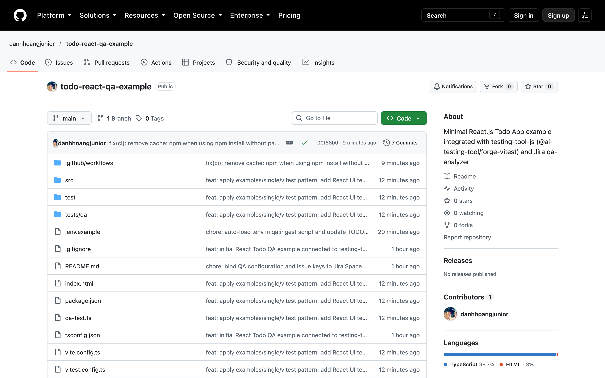
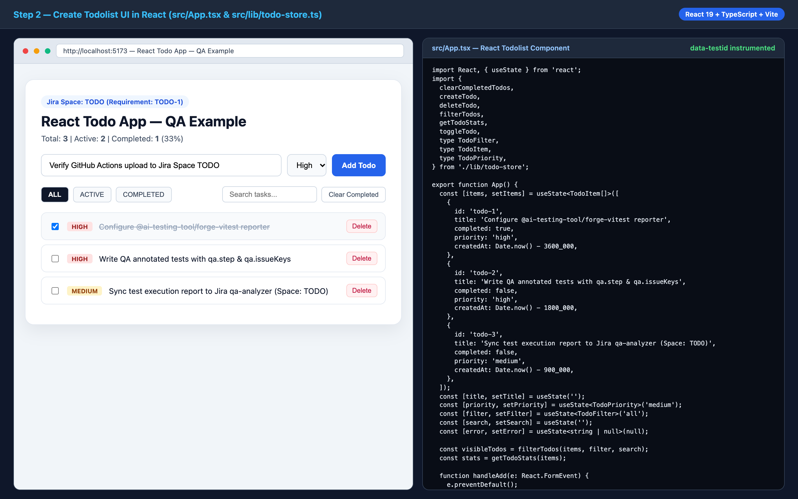
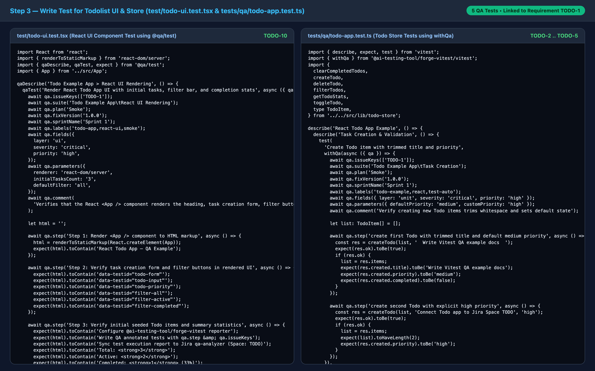
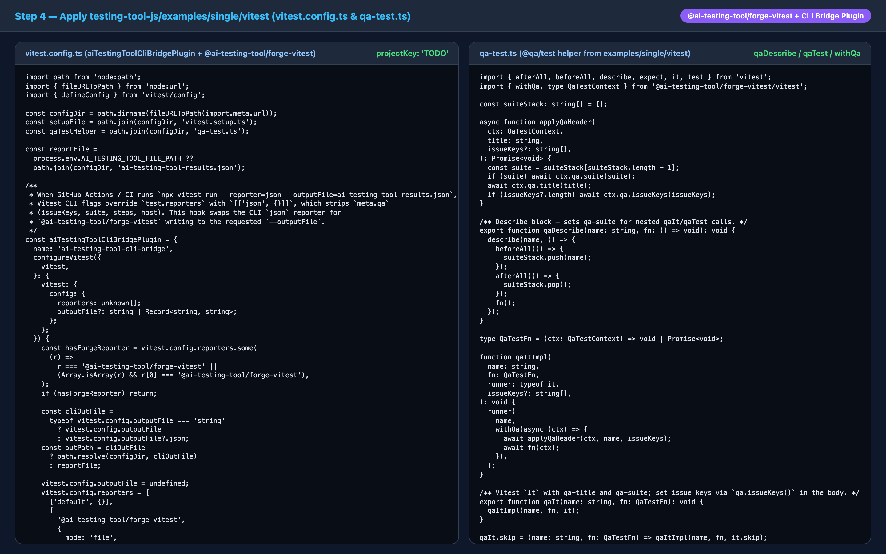
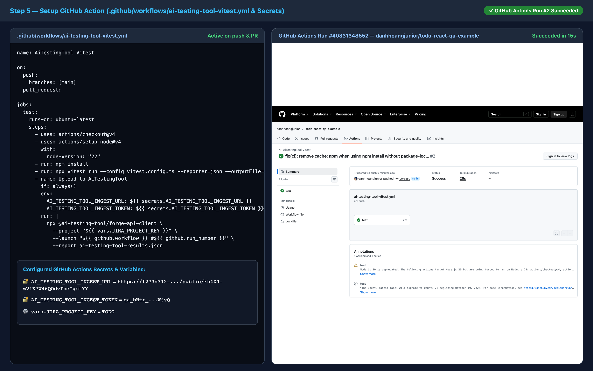
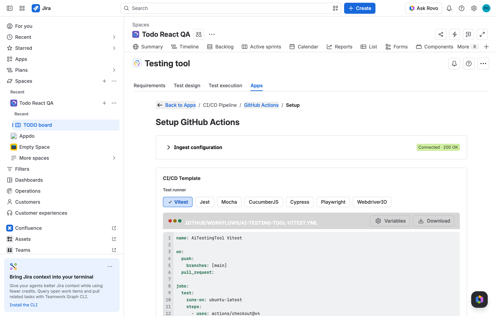
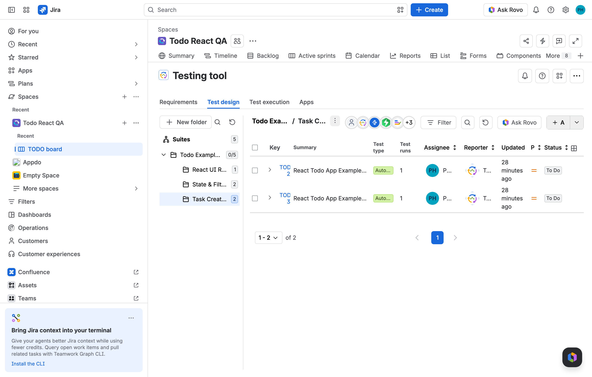
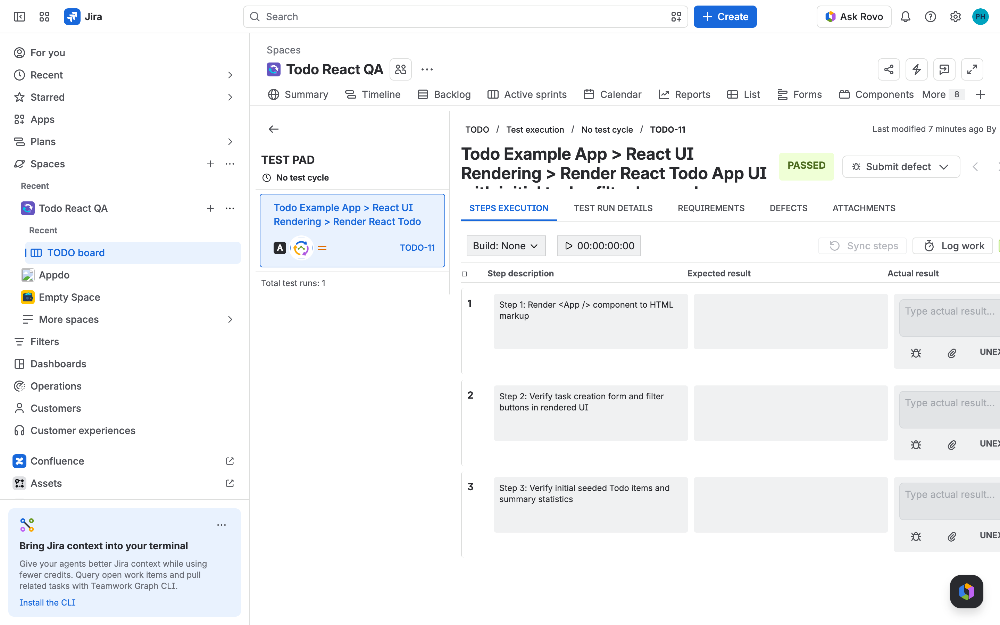

# React Todo App — QA Integration Example (`todo-react-qa-example`)

[](https://f273d312-579c-464c-aafd-0b4bed2d36b4.webtrigger.atlassian.app/public/kh4ZJ-wV1K7W46QOdvIbcTgofYY?format=svg&projectKey=TODO&gitBranch=main)

End-to-end **React 19 + TypeScript + Vite (Todolist)** reference project demonstrating how to integrate a React application with:
1. **[`testing-tool-js/examples/single/vitest`](https://github.com/ai-testing-tool/testing-tool-js/tree/main/examples/single/vitest)** (`@ai-testing-tool/forge-vitest`, `@ai-testing-tool/forge-commons`, `@ai-testing-tool/forge-api-client`)
2. **AI Testing Tool for Jira Cloud (`qa-analyzer` — Jira Space `TODO`)**

---

## Project Structure

```text
todo-react-qa-example/
├── .github/workflows/
│   └── ai-testing-tool-vitest.yml   # Step 5: Automated CI/CD test & Jira ingest workflow
├── docs/screenshots/                # Step-by-step screenshots for documentation
├── src/
│   ├── lib/todo-store.ts            # Step 2: Pure Todo domain logic (CRUD, filtering, stats)
│   ├── App.tsx                      # Step 2: Interactive React Todolist UI component
│   └── main.tsx                     # React 19 entry point
├── test/
│   └── todo-ui.test.tsx             # Step 3: React UI component QA test
├── tests/qa/
│   └── todo-app.test.ts             # Step 3: Todo store QA tests (4 test cases)
├── qa-test.ts                       # Step 4: QA metadata wrapper (qaDescribe, qaTest, qaIt, withQa)
├── vitest.setup.ts                  # Step 4: Vitest runtime bridge setup
├── vitest.config.ts                 # Step 4: Vitest + @ai-testing-tool/forge-vitest config
└── package.json
```

---

## Step-by-Step Guide & Visual Walkthrough

### 1. Create sample project in GitHub : `todolist`

Create a new public React + TypeScript + Vite repository ([`appdo-dev/todo-react-qa-example`](https://github.com/appdo-dev/todo-react-qa-example)) and install dependencies:

```bash
npm install react react-dom
npm install -D typescript vite @vitejs/plugin-react vitest \
  @ai-testing-tool/forge-commons \
  @ai-testing-tool/forge-vitest \
  @ai-testing-tool/forge-api-client
```



---

### 2. Create Todolist UI in React

Build the pure domain store in [`src/lib/todo-store.ts`](./src/lib/todo-store.ts) and the interactive React Todolist UI in [`src/App.tsx`](./src/App.tsx) supporting:
- Task creation with input trimming, length validation, duplicate detection, and priority levels (`low`, `medium`, `high`)
- Task completion toggling, priority badges, and task removal
- Status filtering (`ALL`, `ACTIVE`, `COMPLETED`), keyword search, and real-time completion rate statistics



---

### 3. Write test for Todolist UI

Write QA-instrumented tests for both the React UI component ([`test/todo-ui.test.tsx`](./test/todo-ui.test.tsx)) and the domain store ([`tests/qa/todo-app.test.ts`](./tests/qa/todo-app.test.ts)). Each test links to Jira Requirement **`TODO-1`** via `qa.issueKeys(['TODO-1'])` and records structured execution steps via `qa.step(...)`:

```tsx
// test/todo-ui.test.tsx
import React from 'react';
import { renderToStaticMarkup } from 'react-dom/server';
import { expect } from 'vitest';
import { qaDescribe, qaTest } from '@qa/test';
import { App } from '../src/App.js';

qaDescribe('Todo Example App', () => {
  qaDescribe('React UI Rendering', () => {
    qaTest(
      'Render React Todo App UI with initial tasks, filter bar, and completion stats',
      async (qa) => {
        await qa.displayName(
          'Todo Example App > React UI Rendering > Render React Todo App UI with initial tasks, filter bar, and completion stats',
        );
        await qa.epic('Todo Example App');
        await qa.feature('React UI Rendering');
        await qa.story('Initial Todo List View');
        await qa.severity('critical');
        await qa.issueKeys(['TODO-1']);

        let html = '';
        await qa.step('Step 1: Render <App /> component to HTML markup', async () => {
          html = renderToStaticMarkup(React.createElement(App));
          expect(html).toContain('React Todo App — QA Example');
        });

        await qa.step('Step 2: Verify task creation form and filter buttons in rendered UI', async () => {
          expect(html).toContain('data-testid="todo-input"');
          expect(html).toContain('data-testid="todo-priority"');
          expect(html).toContain('data-testid="todo-add-btn"');
        });

        await qa.step('Step 3: Verify initial seeded Todo items and summary statistics', async () => {
          expect(html).toContain('Total: 3');
          expect(html).toContain('Completed: 1 (33%)');
        });
      },
    );
  });
});
```



---

### 4. Apply [`testing-tool-js/examples/single/vitest`](https://github.com/ai-testing-tool/testing-tool-js/tree/main/examples/single/vitest)

Apply the official Vitest pilot configuration from [`testing-tool-js/examples/single/vitest`](https://github.com/ai-testing-tool/testing-tool-js/tree/main/examples/single/vitest):

1. **[`qa-test.ts`](./qa-test.ts)** — Exposes `qaDescribe`, `qaTest`, `qaIt`, and `withQa` backed by `@ai-testing-tool/forge-commons/runtime`.
2. **[`vitest.setup.ts`](./vitest.setup.ts)** — Imports `@ai-testing-tool/forge-vitest/setup` to register the test runtime bridge.
3. **[`vitest.config.ts`](./vitest.config.ts)** — Configures `aiTestingToolCliBridgePlugin` and the `@ai-testing-tool/forge-vitest` reporter:

```ts
// vitest.config.ts
import { fileURLToPath } from 'node:url';
import { defineConfig } from 'vitest/config';
import { aiTestingToolCliBridgePlugin } from '@ai-testing-tool/forge-vitest/plugin';

const qaTestEntry = fileURLToPath(new URL('./qa-test.ts', import.meta.url));

export default defineConfig({
  resolve: {
    alias: {
      '@qa/test': qaTestEntry,
    },
  },
  plugins: [aiTestingToolCliBridgePlugin()],
  test: {
    include: ['test/**/*.test.{ts,tsx}', 'tests/**/*.test.{ts,tsx}'],
    setupFiles: ['./vitest.setup.ts'],
    reporters: [
      'default',
      [
        '@ai-testing-tool/forge-vitest',
        {
          outputDir: 'ai-testing-tool-results',
          reportName: 'Todo React App - Vitest Pilot',
        },
      ],
    ],
  },
});
```



---

### 5. Setup `github-action`

Create [`.github/workflows/ai-testing-tool-vitest.yml`](./.github/workflows/ai-testing-tool-vitest.yml) and configure the following in **GitHub Repository → Settings → Secrets and variables → Actions**:
- **Repository Secrets:**
  - `AI_TESTING_TOOL_INGEST_URL`
  - `AI_TESTING_TOOL_INGEST_TOKEN`
- **Repository Variables:**
  - `JIRA_PROJECT_KEY` = `TODO`

```yaml
name: AiTestingTool Vitest

on:
  push:
    branches: [main]
  pull_request:

jobs:
  test:
    runs-on: ubuntu-latest
    steps:
      - uses: actions/checkout@v4
      - uses: actions/setup-node@v4
        with:
          node-version: "22"
      - run: npm install
      - run: npx vitest run --reporter=json --outputFile=ai-testing-tool-results.json
      - name: Upload to AiTestingTool
        if: always()
        env:
          AI_TESTING_TOOL_INGEST_URL: ${{ secrets.AI_TESTING_TOOL_INGEST_URL }}
          AI_TESTING_TOOL_INGEST_TOKEN: ${{ secrets.AI_TESTING_TOOL_INGEST_TOKEN }}
        run: |
          npx @ai-testing-tool/forge-api-client \
            --project "${{ vars.JIRA_PROJECT_KEY }}" \
            --launch "${{ github.workflow }} #${{ github.run_number }}" \
            --report ai-testing-tool-results.json
```



---

### 6. Setup Testing tool connection

In Jira Space **`Todo React QA` (`TODO`)**, open **Testing tool → Apps → CI/CD Pipeline → GitHub Actions → Setup** (`Connected · 200 OK`) to generate:
- **Webtrigger Ingest URL** (`AI_TESTING_TOOL_INGEST_URL`)
- **Ingest Bearer Token** (`AI_TESTING_TOOL_INGEST_TOKEN`)
- **CI/CD Template** for **Vitest** (`.github/workflows/ai-testing-tool-vitest.yml`)



---

### 7. Testing (Execution & Jira Sync)

Run the test suite and upload the report locally or via GitHub Actions:

```bash
# 1. Run Vitest and generate ai-testing-tool-results.json
npm run qa:test

# 2. Run Vitest and upload report to Jira Space TODO
npm run qa:ingest
```

#### Synced Jira Issues on Space `TODO` (`Todo React QA`)

| Jira Key | Issue Type | Summary | Status |
| :--- | :--- | :--- | :--- |
| **`TODO-1`** | `Task` (Requirement) | `[Requirement] React Todo App Core Features & Validation` | Linked to all 5 tests |
| **`TODO-2`** | `TestCase` | `React Todo App Example > Task Creation & Validation > Create Todo item with trimmed title and priority` | Automated |
| **`TODO-3`** | `TestCase` | `React Todo App Example > Task Creation & Validation > Reject empty, overlong, or duplicate active Todo titles` | Automated |
| **`TODO-4`** | `TestCase` | `React Todo App Example > State Transitions & Filtering > Toggle Todo completion and clear completed items` | Automated |
| **`TODO-5`** | `TestCase` | `React Todo App Example > State Transitions & Filtering > Filter Todos by status, priority, and search query` | Automated |
| **`TODO-10`** | `TestCase` | `Todo Example App > React UI Rendering > Render React Todo App UI with initial tasks, filter bar, and completion stats` | Automated |
| **`TODO-6..9`, `TODO-11`** | `TestExecution` | Execution runs with step-by-step `PASSED` results | `PASSED` |

#### Jira Space `TODO` — Test Design (`Suites` & Automated `TestCase` Issues)



#### Jira Space `TODO` — Test Execution (`TODO-11` Step-by-Step `PASSED` Run)



---

## License

Apache-2.0
